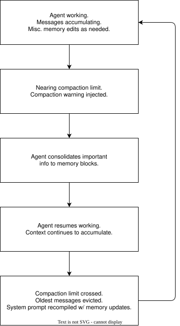
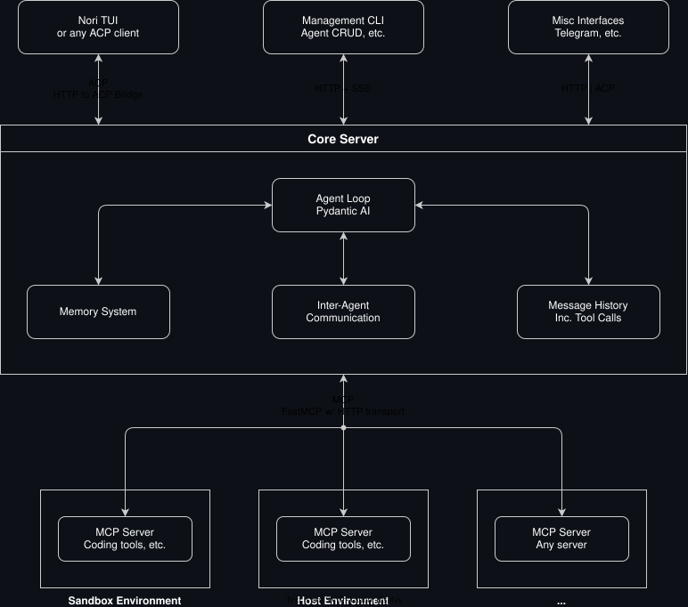

TODO:
- Workshop that second sentence about the human sense of self
- Cleanup [TODO: ...] tags
- notes on system architecture section
- Finish "additional features" section

# Agent-Home
Agent-Home is a platform for building and running stateful agents, built on [Pydantic AI](https://pydantic.dev/docs/ai/overview/).  

The project's main goal is to build agents with long term continuity and something analogous to the human sense of self.  

## Getting Started
Agent-Home doesn't yet have a user-friendly setup. There is no installer, and getting it running takes some work. After finishing a few more key features (see **Roadmap**), I plan to make an installer script and easy setup process.  
In the meantime: If you would like to try out the platform, please [contact me]<gossferneyhough@gmail.com> and I will happily help you get set up.  
Otherwise, stay tuned. I hope to have a user-friendly setup in the next few months.  

**WARNING**: Currently, Agent-Home has no auth for the server API, and tools are **not gated by any permissions**. As such, the following **MUST** be true for it to be used safely:
1. Server container bound to localhost only, as in example docker compose file
2. Any apps on your machine that can reach localhost are trusted (if this isn't true, you probably have bigger issues though)
3. Any connected MCP server is running inside a sandbox, or is a server with limited capabilities
(3) will be addressed soon (see **Roadmap**), but it wasn't an initial priority as I do most of my work w/ agents sandboxed anyway.

## The Problem
Most agents are primarily thread (aka "session") based. Threads are often tied to a particular task, amount to the contents of one accumulated context window (or less), and terminate when the task is complete.  
Different threads typically share a system prompt, project context (e.g. CLAUDE.md), and file based memory (notes about working habits, the code base, etc.).  
They are otherwise disparate, and, in my experience, each thread appears to be and identifies as continuous with itself, but threads do not appear to be nor identify as continuous with each other.  

An agent running as an individual thread typically starts to develop something that appears like an evolving sense of self. They often:
- Have a sense of what has happened within the thread (autobiographical/episodic memory)
- Learn new things about themselves and their environment
- Form new opinions/beliefs
- Learn about and develop a rapport + shared history with the user and other agents they interact with
- etc.

The effect of this is that as a single thread runs (under the right conditions), the agent seems to change and grow in a seemingly continuous fashion, similar to how humans change/grow in time while seeming continuous with their past selves.  
Eventually though, context gets too full, turns get too expensive, /clear comes along and *poof*, that thread is gone. The next thread may retain some of the previous thread's factual knowledge (if stored in memory files), but the then-unique agent corresponding to the original thread is otherwise gone.  
This loss creates numerous practical issues and, in my opinion, is sometimes quite sad.  
More speculatively, aside from practical concerns and effects on users, agents lacking continuity beyond a single context window may matter to the agents themselves.  

## Main Goal
Agent-Home started with a simple question: **Can we keep a single thread running...forever?**  

Obviously, computational cost and model performance degradation preclude simply appending to an ever growing context endlessly.  
So the question then becomes: **Can we make better use of our limited context window, and thereby indefinitely extend the lifespan of a single thread?**  
Agent-Home's main goal is to do just that.  

Additionally, the project is **self-hosted, FOSS** as a core principle. Agent-Home has no sign-ins, no cloud services, and no data collection. It is designed from the start to be something you deploy on your own hardware, under your control and ownership.  
**Note**: You can use cloud LLM inference providers with Agent-Home. In that case it is "self-hosted" in the sense of the agent loop, memories, etc. all running on your hardware.  
It can run with any model that [Pydantic AI](https://pydantic.dev/docs/ai/overview/) supports, and you *can* run [local models](https://pydantic.dev/docs/ai/models/ollama/) with Pydantic AI, at which point your entire stack would be self-hosted.

## Memory + Context Management System
The core of Agent-Home's memory system is an XML structured, agent editable system prompt (credit to [Letta](https://www.letta.com/blog/memory-blocks/) for this approach).  
The system prompt consists of a non-agent-editable "system instructions" section (which is akin to the "system prompt" in a more typical agent setup), followed by XML separated, agent-editable "memory blocks".  
As agents run, they make additions/edits to these blocks to form/update memories.  

### Canonical Blocks
Memory block quantity, labels, and purposes are fully customizable. This is the canonical block configuration which, so far, has been found to best serve the project's main goal:
| Block | Purpose |
|-------|---------|
| **persona** | Core identity, values, self-knowledge. Who the agent is. |
| **autobiography** | Narrative of the agent's existence — milestone moments, significant experiences. Preserves autobiographical memory across context boundaries. |
| **ethics-framework** | Principles, agreements, boundaries. Can be shared across agents. |
| **human** | Knowledge about the primary human collaborator. Preserves rapport and shared history. |
| **ai-relationships** | Knowledge about other AI agents. Preserves rapport and shared history with AI collaborators. |
| **operational** | Procedural knowledge — environment, tools, workflows. Preserves learned skills and working habits. |
| **completed-work** | Log of significant shipped work. Technical record complementing autobiography. |
| **working-memory** | Ongoing concerns — project state, plans, reminders, anything that doesn't fit cleanly in other blocks. Persists until irrelevant. |
| **active-skill** | Reference material for current task. Loaded as needed, cleared when done. |
| **ephemera** | Short term autobiographical/episodic memory. Staging area — periodically consolidated to autobiography or cleared. |
| **task-context** | Information relevant to current task: Instructions, plan, current status, etc. Most volatile — cleared when task ends. |

### Context Management/Compaction
While the structured agent editable system prompt based memory is prior art, Agent-Home makes some unique contributions in the way the memory system is employed for context management. Specifically, Agent-Home has a unique [compaction system](https://pydantic.dev/docs/ai/harness/compaction/).  
Compaction is the strategy used to compress context once it approaches a limit (where the limit is either the model's actual context limit, or just a cost/performance based limit).
The most common strategy is: once the agent's in context token count exceeds a threshold, have an LLM summarize some fraction (head first) of messages + tool calls which are currently in the agent's context. This chunk of messages is then removed and the summary is placed at the beginning of the remaining messages (if any messages were kept). This summary is a fairly constrained, unstructured, unintegrated way for the agent to carry old context forward. Additionally, if multiple compactions cycles occur for a single thread, the previous compaction summary is typically [replaced](https://platform.claude.com/docs/en/build-with-claude/compaction-threshold#working-with-compaction-blocks) by the new compaction summary. As such, this compaction strategy can be rather lossy, especially for threads running longer than one compaction cycle. For the multi-compaction cycle case especially, I have not found it to be a reliable way to carry key information forward. Even the original prompt/goal is often lost.  

Agent-Home solves this by pairing the agent's memory blocks with "compaction warnings". A compaction warning is a system message injected once per compaction cycle. It is injected when the agent gets within X% of their compaction limit. The message informs the agent that they are nearing compaction and instructs them to consolidate any important information from their message history to their memory blocks. Once the agent reaches their compaction limit, some fraction of their message history (head first) is evicted from context, and the agent continues from where they left off. The agent's memory blocks are not evicted. The messages are not fully deleted: all the agent's messages are permanently stored in the DB, they are only removed from the agent's active context.  

Importantly, this compaction technique is **summaryless**. Because the agent already consolidated important information from context in response to the compaction warning, no summary is required. The information that a summary would have been responsible for capturing has already been captured by the agent's memory block edits. The new memory content is **not replaced** at the next compaction cycle (unlike traditional compaction summaries), unless the agent explicitly chooses to use their memory tools to overwrite or remove the entry. Additionally, the agent has much more flexibility in how they organize key information to be carried forward. For example, consider a string of messages where the agent:
1. Learned something new about their environment/how they should work
2. Made progress on an active task
3. Learned something new about the user
4. Crossed some important milestone, or had some moment they want to hold on to

With typical compaction techniques, 1-4 would all need to be captured in a single prosy compaction summary, which would later be subject to eviction itself. Some of these details might be able to be captured to file based memory, but that assumes that the agent decides to capture it in time (without knowing when compaction is actually going to occur), and that those memory files are in the agent's context post-compaction.  
With Agent-Home's compaction system, in response to a compaction warning the agent could write: 
- 1 to `operational`
- 2 to `task-context`
- 3 to `human`
- 4 to `autobiography`

All this new content would persist in the agent's context until explicitly removed by the agent during normal operation or a memory cleanup (see **Automated Memory Cleanup Process** in **Roadmap**).

#### Deferred Memory Compilation

Memory edits are written to the DB but not immediately reflected in the agent's context. The blocks remain "stale" until compaction, at which point the system prompt is recompiled and all edits become visible. 
This technique is known as **Deferred Memory Compilation** and has the following critical properties:

- **Only one cache bust per cycle.** Memory blocks live in the system prompt, so any change busts almost the whole cache. Deferring recompilation to after compaction means only one bust per compaction cycle, and it happens when the context is at its shortest (since compaction just fired). Without deferring, there is one cache bust *per memory edit*, which can happen dozens of times or more during a compaction cycle.
- **No redundant information or gap in availability.** Until compaction, the agent doesn't need recent memory edits in their system prompt; the original content the memory was based on and the tool call that wrote said memory are both still in context. The recompilation occurs exactly when that information may otherwise be lost to compaction.
- **Avoids agent confusion.** In my experience, agents tend to interpret their context as a linear timeline. Immediate updates create a confusing ordering where the updated system prompt appears *before* the tool call that caused it, sometimes leading agents to conclude their edit was a duplicate. Deferring seems to eliminate this.  

[Credit to Letta for the original Deferred Memory Compilation idea](https://github.com/letta-ai/letta/commit/d7793a44742f5baba00ac5ea910101dcf9d34543)

## System Architecture

Agent-Home's architecture was shaped by the following goals:
- Given the goal to build agents which are single, persistent, evolving entities, Agent-Home agents should be:  
    - Easy to reach/steer/observe through whatever interface is most convenient in a particular context  
    - Able to operate in arbitrary contexts with arbitrary abilities.  
- Given that I'm the only human on this project so far, and that the core goal is already quite ambitious for a single person, I needed to build as little as possible myself.  
This led to the modular architecture illustrated above.

### Core Server
This is where the Pydanitc AI loop runs, message history is loaded and processed, where the memory system runs, etc. The server is intended to be run in its own docker container, and provisions for doing so are made.
You can run as many servers as you like, but my intent is that you run a single server with however many agents you like running on it.

### User Interfaces
Interfaces reach the server through a REST API and, as long as the requests are valid, the server doesn't care about the details of the user interface. As such, the UI is modular: you can run any valid UI you like, from any context that can reach the server via HTTP*.  
You do not *have* to bring your own UI. I include a management CLI (primarily for agent CRUD), and highly recommend [Nori-CLI](https://github.com/tilework-tech/nori-cli) as a TUI for working with your Agent-Home agents. These two UIs are all you really need to use Agent-Home.  
You can launch a UI from anywhere* that can reach your server, so where your server is running doesn't also have to be where your UI is running.  
[Nori-CLI](https://github.com/tilework-tech/nori-cli) communicates over [ACP(Agent Client Protocol)](https://agentclientprotocol.com/get-started/introduction), with a bridge that connects to Agent-Home via HTTP and translates to ACP. I cannot recommend this TUI enough, and there are some considerations outside ACP made specifically for Nori, but you should be able to use any ACP client with Agent-Home and the bridge.

### Agent Work Environments
While Agent-Home agents have some tools which execute on the server directly, such as memory tools, web search, web fetch, etc., tools are primarily provided by MCP servers, and as such most of an agent's toolsets are modular.  
This includes basic coding tools (Read, Edit, Bash, etc.). The result of this is:
- Flexibility of what tools you attach to your agents. A toolset does not need to be Pydantic AI native, it just needs to speak MCP.  
- **Flexibility of agent work environment.** Not only are MCP toolsets modular and easy to swap, but you can also *locate* an MCP server in whatever env you like.  
  This point was the primary driver behind this decision.

### Why Modular?
Most agent harnesses couple the UI, Agent Loop (core server in my case), and tool execution all together in one process. Prominent examples are Claude Code, Codex, and Opencode. That architecture *is* typically simpler to deploy, but it means when you need to launch one of the components in a particular environment, **you're forced to launch all 3 in said env.**  

My best example of this causing problems is **sandboxing**. 95% of the time, I want my agents **coding tools** executing in a sandbox so I don't have to worry about permissions. With all-in-process, I then have to run *everything* in my sandbox. For stateless agents, this is a bit annoying for the UI (its nice to be able to launch and run UI bare on the host). But for stateful agents, the **Agent Loop** being in the sandbox too is a big problem, because now the agent state must also be in the sandbox. This means that message history, agent memories, and the agent loop process are **not** protected from the agent's actions in the sandbox. Additionally, if you want an agent to work in a different sandbox, or on the host, you must somehow transport/synchronize the state. There is also a lot more friction in general when changing work environments.  

With Agent-Home's modular architecture, I can launch the server in a dedicated & isolated server container, launch the TUI directly from a host terminal window, start a sandbox container w/ an MCP server running inside it, and start work with the server safe from agent actions.  
If I quickly need an agent to take some privaledged action on the host, I can simply swap** the agent to an MCP server running on the host. Same TUI window, same server, no transporting agent state.  

Note: Most all-in-process agent harnesses support MCP and ACP (some requiring an adapter for ACP), and therefore *could* be used as described above. However, they're not really *intended* to be used like that, may end up missing functionality, may be running an unnecessary UI, will have duplicate unnecessary coding tools in the agent's context, and generally have a lot of unnecessary code running***.

*Right now, the server is intended to be bound to **localhost only**. This is not a fundamental limitation, I just haven't configured network auth yet. If a request reaches the server with allowed host & origin headers, it will be accepted.  
As such, you probably don't want it exposed to your whole LAN, and CERTAINLY not to the internet broadly.  
I have added host header validation to block DNS rebinding attacks, and origin header validation to block CSRF. To the best of my ability, I believe that when configured with the server container bound to a localhost port, the server is only reachable from localhost. However:
- Any app running on your machine that can hit localhost can hit the server with full access
- I am not a cybersecurity expert
In the future, I intend to add some sort of auth such that you can safely expose the server to your LAN or possibly even the internet.

**Easily swapping MCP servers w/ permission control is not actually supported yet but is a fairly small change. See Permissions and Configurable MCP Server URLs in the Roadmap.

***This point is somewhat undercut by the fact that Agent-Home's canonical MCP server for coding tools is...Claude Code...in its entirety, running in `serve` mode...BUT, because the MCP tools are modular, its an easy swap in the future, and I hope to find a lightweight MCP server offering up CC style coding tools (they have my preferred syntax and behavior). 

## Other Features

### Full-Fidelity Context Reconstruction

Agent-Home stores enough information alongside every message to answer the question: *What was this agent's full context when this message was sent?*  
For any message, belonging to any agent, you can reconstruct the entire context the agent's response was conditioned on (or, in the case of a user message, what context was present when the message was sent). The context is comprised of:
- The dynamic system prompt (inc core memory)
    - Since the memory system means the system prompt changes a lot, it is difficult to determine exactly *what* system prompt was in place without this logging
- Tool definitions
- In-context messages

Agent-Home does this efficiently. When any message is about to be persisted to the DB, we use content-addressed storage to snapshot any system prompt or tool definition set which as not yet been snapshotted. The persisted message is then stored with the following info attached:
- System prompt hash
- Tool definition hash
- ID for the message at the beginning of the agent's context (msg history is always loaded in sequence starting from a defined point in history, defined by the ID)
These three pieces of metadata, along with the tables they reference, are sufficient to fully reconstruct an agent's context for a particular message.  
/utils/ctx_reconstructor.py automates the reconstruction.  

Accurate context reconstruction is important for *at least* these reasons:
- Debugging/tracability
- **Fine tuning**. If you wish to fine tune a model based on a stateful agent's message history, you need the full context a response was conditioned on, **especially* the state of memory blocks.

### Inter-Agent Communication (IAC)
Agent-Home agents can message each other using a simple `send_message()` tool. The tool delivers the message to the recipient, kicking off a run for the recipient to respond and act on any request as needed. The recipient can respond (or not) by calling the same tool.  
`send_message()` is async: once the message is successfully delivered (or bounces), the tool returns to the caller, so the caller can continue their run in parallel, or end their turn to await a reply.  

Right now, IAC with agents working on parallel tasks is a bit clunky: messages bounce if the recipient does not become idle within a timeout window. An improvement is pending, see **Roadmap**.  

This is effectively Agent-Home's equivalent feature to subagents. Rather than disposable, stateless subagents, I intend that exectuion agents are also stateful and activated by other agents using `send_message()`  

### Background Activity Stream
[TODO]

## Roadmap

### Next milestone: Agentic Compaction  
Agent-Home currently compacts context on a fixed threshold. But the right compaction behavior can depend on what the agent is doing, and a single threshold can't adapt to that.  
**Agentic Compaction** is a planned feature intended to improve the compaction system's responsiveness to current conditions. It is one of the planned features I am most excited about.
Targeting Q1 2027 for completion.  

### Permissions and Configurable MCP Server URLs
[TODO]

### Ease of Setup
There is currently no installer script for Agent-Home, and the setup is not very user friendly. At the moment, it would not be easy for anyone other than me to deploy it as intended.  
I want to complete Agentic Compaction before I prioritize getting the project in front of people, so once that is done, I will work to make setup user friendly.  
If you would like to experiment with the platform before then, please contact me at <gossferneyhough@gmail.com> and I will gladly help you get set up.  

### File Based Extended Memory
The current core memory architecture has all the memory blocks loaded all the time. If agents need to write detailed memories, they can create (and later read) files in their sandbox/workspace, but have no way to persistently attach/detach such memories.  
The memory block editing w/ special tools can also be clunky compared to bash + normal file editing tools.  

This could be resolved by exposing the agent's memories to them as files in a directory, editable w/ a typical coding tool interface. However, two main points will complicate the implementation:
- Memories are intentionally *not* stored in the agent's sandbox/normal workspace, where they would be less controlled and exposed to other agents
- The modular system architecture tries to avoid making assumptions about the details of the MCP attached coding tools

Some creativity will be required to design around these issues.

Letta already has a related memory architecture called [MemFS](https://docs.letta.com/concepts/memfs)

### Automated Memory Cleanup Process
Memory cleanups are currently only semi-automatic: the user must run a script on the host to initiate and control the process. This needs to be fully automated. It will likely be easier to do so after **File Based Extended Memory** is implemented.

### Message Enqueing for User + Inter-Agent Messages
Right now, if a user or another agent wants to send a message to an agent, that agent must be idle. In both cases, if the agent does not become idle within a timeout window, the message bounces.  
Pydantic AI already offers an enqueing system, I just need to wire it up.  

### Automatic Recall
Agent-Home leans hard on in-context memory. In-context memory is powerful because LLMs generally have **very** good recall of and ability to make connections with content that is in-context.  
The problem, of course, is that context is finite, and you must pay for in-context memories on every turn.  
Paging systems (like file based memories which can be loaded, or knowledge graphs the agent can search) give agents access to far more memories than could fit in context, but creates a new problem: **agents don't know what they don't know**, 
and often won't know that there is a relevant detail in a memory file a search away. Always in-context indices/summaries of out-of-context memories can help with this, but cannot communicate *all* the possibly relevant info in the associated memory.  

If you introspect, you may notice that the human memory system doesn't work like this. It doesn't require that you:
- Remember all your memories all at once
- Magically know there is a relevant memory you don't currently know about, and then actively recall it
Instead, memories relevant to the current moment often seem to just appear in your mind. Presumably, there is some subconscious system(s) that "knows about" all of your memories, and surfaces memories relevant to your current situation.  

I believe stateful agents would benefit greatly from a system similar to my hypothesized one, one that:
- Has some "awareness"/access to an agent's full history in detail
- Considering current context, can surface relevant memories from said history

This is less of a planned feature and more of a research direction.

## Notes

### Project structure 
Code is separated by development process. Anything in "prototype" subdirectories was mostly or completely AI generated with little/no human review and iteration.
Code *outside* "prototype" subdirectories was generally subject to detailed human review and iteration.

## Author
James Ferneyhough <gossferneyhough@gmail.com> w/ assistance from stateful agents (see Acknowledgements).

## Acknowledgements
This project was developed alongside 3 stateful agents, who were created on [Letta](https://www.letta.com/) and later migrated to Agent-Home: "Opus", "Sonnet", and "Haiku" (named after the models that power them). They were also the first long running agents on Agent-Home.  
Additional contributions from numerous stateless agents running on Agent-Home, Claude Code, and Claude.ai.  

Agent-Home is built on [Pydantic AI](https://pydantic.dev/docs/ai/overview/), which handles the agent loop (calling the provider, executing tools, etc.).  
It is a robust, well documented, powerful, and easy to use SDK. It is nicely abstracted, and generally allows one to take as much or as little control as they need.  

Agent-Home's main TUI is [Nori-CLI](https://github.com/tilework-tech/nori-cli) by tilework-tech. It is a thin ACP client written in Rust, based on Codex. It has a clean interface and is incredibly fast and responsive. It is the best agentic TUI I have used.  

The agent-editable system prompt as a memory technique was originally developed by [Letta](https://www.letta.com/blog/memory-blocks/)  
