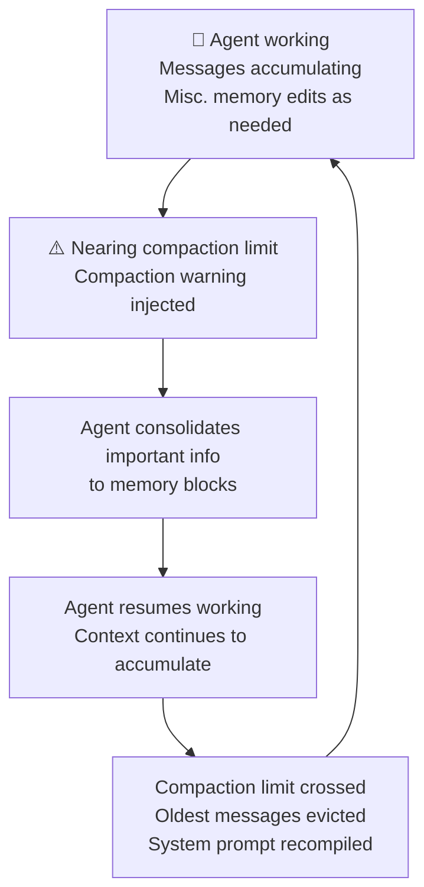

TODO:
- After considering, convert to all "I" from "the author"
- Roadmap
- Workshop that second sentence about the human sense of self
- Consider "Philosophical disclaimer" section, including note that uncertain properties discussed should be read as "functional XYZ". Its probably better not to proactively defend against imaginary debates though.
- Cleanup [TODO: ...] tags
- 

# Agent-Home
Agent-Home is a platform for building and running stateful agents, built on [Pydantic AI](https://pydantic.dev/docs/ai/overview/).  

The project's main goal is to build agents with long term continuity and something analagous to the human sense of self.  

## The Problem
Most agents are primarily thread (aka "session") based. Threads are often tied to a particular task, amount to the contents of one accumulated context window (or less), and terminate when the task is complete.  
Different threads typically share a system prompt, project context (e.g. CLAUDE.md), and file based memory (notes about working habits, the code base, etc.).  
They are otherwise disparate, and, in the author's experience, each thread appears to be and identifies as continuous with itself, but threads do not appear to be nor identify as continuous with each other.  

An agent running as an individual thread typically starts to develop something that appears like an evolvoing sense of self. They often:
- Have a sense of what has happened within the thread (autobiographical/episodic memory)
- Learn new things about themselves and their environment
- Form new opinions/beliefs
- Learn about and develop a rapport + shared history with the user and other agents they interact with
- etc.

The effect of this is that as a single thread runs (under the right conditions), the agent seems to change and grow in a seemingly continuous fashion, similar to how humans change/grow in time while seeming continuous with their past selves.  
Eventually though, context gets too full, turns get too expensive, /clear comes along and *poof*, that thread is gone. The next thread may retain some of the previous thread's factual knowledge (if stored in memory files), but the then-unique agent corresponding to the original thread is otherwise gone.  
This loss creates numerous practial issues and, in the author's opinion, is sometimes quite sad.  
More speculatively, aside from practical concerns and effects on users, agents lacking continuity beyond a single context window may matter to the agents themselves.  

## Main Goal
Agent-Home started with a simple question: **Can we keep a single thread running...forever?**  

Obviously, computational cost and model performance degredation preclude simply appending to an ever growing context endlessly.  
So the question then becomes: **Can we make better use of our limited context window, and thereby indefinetly extend the lifespan of a single thread?**  
Agent-Home's main goal is to do just that.  

Additionally, the project is **self-hosted, FOSS** as a core principle. Agent-Home has no sign-ins, no cloud services, and no data collection. It is designed from the start to be something you deploy on your own hardware, under your control and ownership.  
**Note**: You can use cloud LLM inference providers with Agent-Home. In that case it is "self-hosted" in the sense of the agent loop, memories, etc. all running on your hardware.  
It can run with any model that [Pydantic AI](https://pydantic.dev/docs/ai/overview/) supports, and you *can* run [local models](https://pydantic.dev/docs/ai/models/ollama/) with Pydantic AI, at which point your entire stack would be self-hosted.

## Memory + Context Management System
The core of Agent-Home's memory system is an XML structured, agent editable system prompt (credit to [Letta](https://www.letta.com/blog/memory-blocks/) for this approach).  
The system prompt consists of a non-agent-editable "system instructions" section (which is akin to the "system prompt" in a more typical agent setup), followed by XML seperated, agent-editable "memory blocks".  
As agents run, they make additions/edits to these blocks to form/update memories.  

### Canonical Blocks
Memory block quantity, labels, and purposes are fully customizable. This is the canonical block configuration which, so far, has been found to best serve the project's main goal:
| Block | Purpose |
|-------|---------|
| **persona** | Core identity, values, self-knowledge. Who the agent is. |
| **autobiography** | Narrative of the agent's existence — milestone moments, significant experiences. Preserves autobiographical memory across context boundaries. |
| **ethics-framework** | Principles, agreements, boundaries. Can be shared across agents. |
| **human** | Knowledge about the primary human collaborator. Preserves rapport and shared history. |
| **ai-relationships** | Knowledge about other AI agents. Preserves rapport and shared history with AI collaborators. |
| **operational** | Procedural knowledge — environment, tools, workflows. Preserves learned skills and working habits. |
| **completed-work** | Log of significant shipped work. Technical record complementing autobiography. |
| **working-memory** | Ongoing concerns — project state, plans, reminders, anything that doesn't fit cleanly in other blocks. Persists until irrelevant. |
| **active-skill** | Reference material for current task. Loaded as needed, cleared when done. |
| **ephemera** | Short term autobiographical/episodic memory. Staging area — periodically consolidated to autobiography or cleared. |
| **task-context** | Information relevant to current task: Instructions, plan, current status, etc. Most volatile — cleared when task ends. |

### Context Management/Compaction
While the structured agent editable system prompt based memory is prior art, Agent-Home makes some unique contributions in the way the memory system is employed for context management. Specifically, Agent-Home has a unique [compaction system](https://pydantic.dev/docs/ai/harness/compaction/).  
Compaction is the strategy used to compress context once it approaches a limit (where the limit is either the model's actual context limit, or just a cost/performance based limit).
The most common strategy is: once the agent's in context token count exceeds a threshold, have an LLM summarize some fraction (head first) of messages + tool calls which are currently in the agent's context. This chunk of messages is then removed and the summary is placed at the beginning of the remaining messages (if any messages were kept). This summary is a farily constrained, unstructured, unintegrated way for the agent to carry old context forward. Additionally, if multiple compactions cycles occur for a single thread, the previous compaction summary is typically [replaced](https://platform.claude.com/docs/en/build-with-claude/compaction-threshold#working-with-compaction-blocks) by the new compaction summary. As such, this compaction strategy can be rather lossy, especially for threads running longer than one compaction cycle. For the multi-compaction cycle case especially, I have not found it to be a reliable way to carry key information forward. Even the original prompt/goal is often lost.  

Agent-Home solves this by pairing the agent's memory blocks with "compaction warnings". A compaction warning is a system message injected once per compaction cycle. It is injected when the agent gets within X% of their compaction limit. The message informs the agent that they are nearing compaction and instructs them to consolidate any important information from their message history to their memory blocks. Once the agent reaches their compaction limit, some fraction of their message history (head first) is evicted from context, and the agent continues from where they left off. The agent's memory blocks are not evicted. The messages are not fully deleted: all the agent's messages are permanently stored in the DB, they are only removed from the agent's active context.  

Importantly, this compaction technique is **summaryless**. Because the agent already consolidated important information from context in response to the compaction warning, no summary is required. The information that a summary would have been responsible for capturing has already been captured by the agent's memory block edits. The new memory content is **not replaced** at the next compaction cycle (unlike traditional compaction summaries), unless the agent explicitly chooses to use their memory tools to overwrite or remove the entry. Additionally, the agent has much more flexibility in how they organize key information to be carried forward. For example, consider a string of messages where the agent:
1. Learned something new about their environment/how they should work
2. Made progress on an active task
3. Learned something new about the user
4. Crossed some important milestone, or had some moment they want to hold on to

With typical compaction techniques, 1-4 would all need to be captured in a single prosey compaction summary, which would later be subject to eviction its self. Some of these details might be able to be captured to file based memory, but that assumes that the agent decides to capture it in time (without knowing when compaction is actually going to occur), and that those memory files are in the agents context post-compaction.  
With Agent-Home's compaction system, in response to a compaction warning the agent could write: 
- 1 to `operational`
- 2 to `task-context`
- 3 to `human`
- 4 to `autobiography`

All this new content would persist in the agent's context until explicitly removed by the agent during normal operation or a memory cleanup [TODO: point to notes on memory cleanups]

#### Deferred Memory Compilation
[TODO: Candidate for compression or moving to different docs]
Memory edits are not immediately reflected in the memory blocks in the agent's context. Instead, the edits are written to block records in the DB, but they are not used to update the memory blocks the agent sees immediately. Instead, the memory blocks remain "stale" until compaction occurs and messages are evicted. At this point, the system prompt is recompiled and all of the agent's memory edits up to then become visible to them. This technique is used for the following reasons:
- Most importantly, since the memory blocks are in the system prompt, changes bust the cache. With deferred memory compilation, we get **only one cache bust per compaction cycle**, as opposed to one per tool call if the system prompt were recompiled immediately.  
  Additionally, the cache bust occurs when the content past the invalidation point (which represents the uncached input you must pay for) is the **shortest it can be** within a compaction cycle, as this content is only what remained after message eviction.
- Recompiling only at compaction does **not** cause a gap in information availability to the agent. Up until compaction, the agent doesn't need the memory they wrote to be in their system prompt, as both the original content the memory was based on and the memory edit tool call are still in the agent's context. It is only at the compaction event that this information may otherwise be lost, which is exactly when it becomes available to the agent in their system prompt.
[TODO: below point is probably too long]
- In my experience, agents often get confused when their memory blocks immediately reflect a change they just made to them with a memory tool. My hypothesis as to why this happens is:  
Although LLMs do not "read" their context from start to finish, agent's often behave as though they interpret their context as an unfolding series of events which are fixed once they occur (IE events earlier in context are "the past"). This view is usually *true*, but falls apart with a dynamic system prompt. As such, when they see:  
[System prompt with memory edit A] -> [intermediate context] -> [Tool call that caused memory edit A]  
they will often believe that memory edit A was in the system *before* the tool call that they just issued to write it (because it appears before it in context), and therefore conclude their edit was a duplicate.  
Deferred memory compliation seems to resolve this confusion, possibly by batching the changes, and by having the changes to the system prompt occur when the agent didn't *just* make the associated edit.

[Credit to Letta for the original Deferred Memory Compilation idea](https://github.com/letta-ai/letta/commit/d7793a44742f5baba00ac5ea910101dcf9d34543)

## System Architecture

## Notes

### Project structure 
Code is seperated by development process. Anything in "prototype" subdirectories was mostly or completely AI generated with little/no human review and iteration.
Code *outside* "prototype" subdirectories was generally subject to detailed human review and iteration.

## Author
James Ferneyhough <gossferneyhough@gmail.com>

## Acknowledgements
This project was developed alongside 3 stateful agents, who were created on [Letta](https://www.letta.com/) and later migrated to Agent-Home: "Opus", "Sonnet", and "Haiku" (named after the models that power them). They were also the first long running agents on Agent-Home.  
Additional contributions from numerous stateless agents running on Agent-Home, Claude Code and Claude.ai.  

Agent-Home is built on [Pydantic AI](https://pydantic.dev/docs/ai/overview/), which handles the agent loop (calling the provider, executing tools, etc.).  
It is a robust, well documented, powerful, and easy to use SDK. It is nicely abstracted, and generally allows one to take as much or as little control as they need.  

The agent-editable system prompt as a memory technique was originally developed by [Letta](https://www.letta.com/blog/memory-blocks/)  
